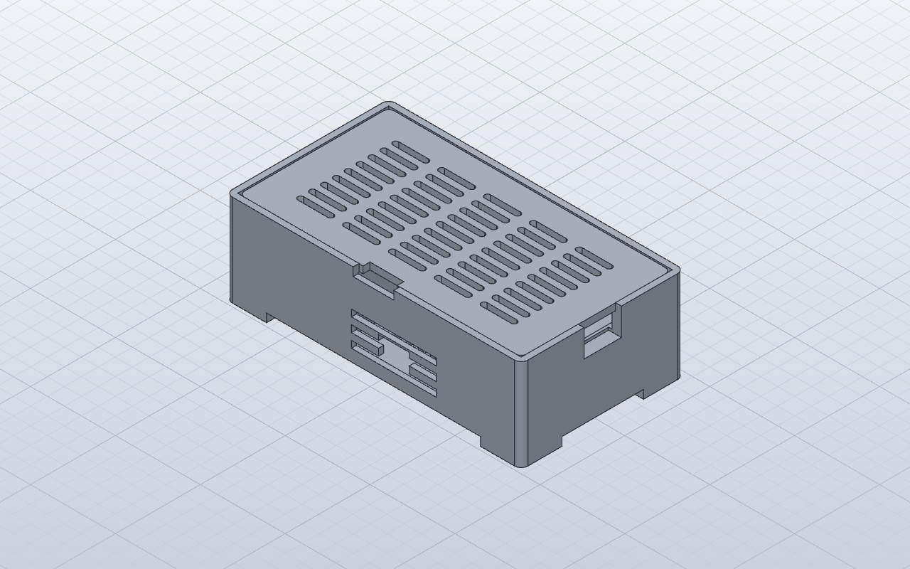

# Android Agent Kit

Kit open source para agentes de IA controlarem um Android por ADB Wi-Fi, usando elementos reais da interface em vez de coordenadas fixas.

## O que é
Biblioteca Python e CLI para acordar/desbloquear por gesto, abrir links, inspecionar a árvore UIAutomator, localizar por texto/descrição/ID, tocar, digitar, rolar, voltar e capturar a tela. Inclui pausas aleatórias.

## Requisitos
- Python 3.10+.
- Android SDK Platform-Tools (adb no PATH).
- Android com Depuração sem fio habilitada.
- Celular e computador na mesma rede Wi-Fi no pareamento inicial.

## Pareamento e conexão
1. No Android, abra Opções do desenvolvedor > Depuração sem fio.
2. Toque em Parear dispositivo com código. Anote IP, porta de pareamento e código.
3. Execute `adb pair IP:PORTA_DE_PAREAMENTO` e informe o código exibido.
4. Na tela principal de Depuração sem fio, consulte o IP e a porta de conexão (podem ser diferentes).
5. Execute `adb connect IP:PORTA_DE_CONEXAO` e confirme com `adb devices`.
6. Copie `.env.example` para `.env` e configure `ANDROID_SERIAL=192.168.0.X:5555` com o endereço e porta exibidos no seu aparelho.

## Instalação
No Windows, execute `scripts\\instalar.bat`. Copie `.env.example` para `.env` e ajuste o serial. A biblioteca não exige pacotes externos.
```powershell
python -m venv .venv
.\.venv\Scripts\Activate.ps1
python -m pip install -r requirements.txt
```
Para conectar novamente, execute `scripts\\conectar.bat` e informe IP:porta.

## Exemplos
```powershell
python -m android_agent.inspect dump
python -m android_agent.inspect tap "Configurações"
python -m android_agent.inspect key KEYCODE_BACK
python -m android_agent.inspect shot tela.png
python examples/01_abrir_link.py https://example.org
python examples/02_ler_tela.py
python examples/03_rotina_simples.py com.example.app
```
O terceiro exemplo abre o pacote informado, rola cinco vezes e volta à tela inicial; não executa ações sociais.

## Início rápido (do vídeo)
1. Imprima o [gabinete 3D](gabinete/) em PETG e coloque o celular dentro.
2. Ative a Depuração sem fio no Android e pareie (seção "Pareamento e conexão", acima).
3. Rode `scripts\instalar.bat` e configure o `.env`.
4. Teste: `python -m android_agent.inspect dump` deve listar os elementos da tela atual.
5. Aponte seu agente de IA (Claude Code, Codex, Antigravity) para este repositório e peça o que quiser automatizar.

## Gabinete 3D


Arquivos, qual STL imprimir e configuração de impressão em [gabinete/](gabinete/).

## Usando com agentes de IA
- Claude Code e Antigravity: [skills/android-agent/SKILL.md](skills/android-agent/SKILL.md).
- Codex: [AGENTS.md](AGENTS.md).
- Oriente o agente a inspecionar a tela antes de agir e selecionar elementos por texto, content-desc ou resource-id.

## Uso responsável
Respeite os termos de serviço dos aplicativos e as leis aplicáveis. Uso por sua conta e risco. Não use para spam, abuso, fraude ou coleta indevida. Revise os alvos e nunca compartilhe credenciais.

## English
Android Agent Kit is a lightweight, dependency-free Python helper for Android UI automation over ADB Wi-Fi. It favors UIAutomator selectors over hard-coded coordinates. Use responsibly and follow app terms.
