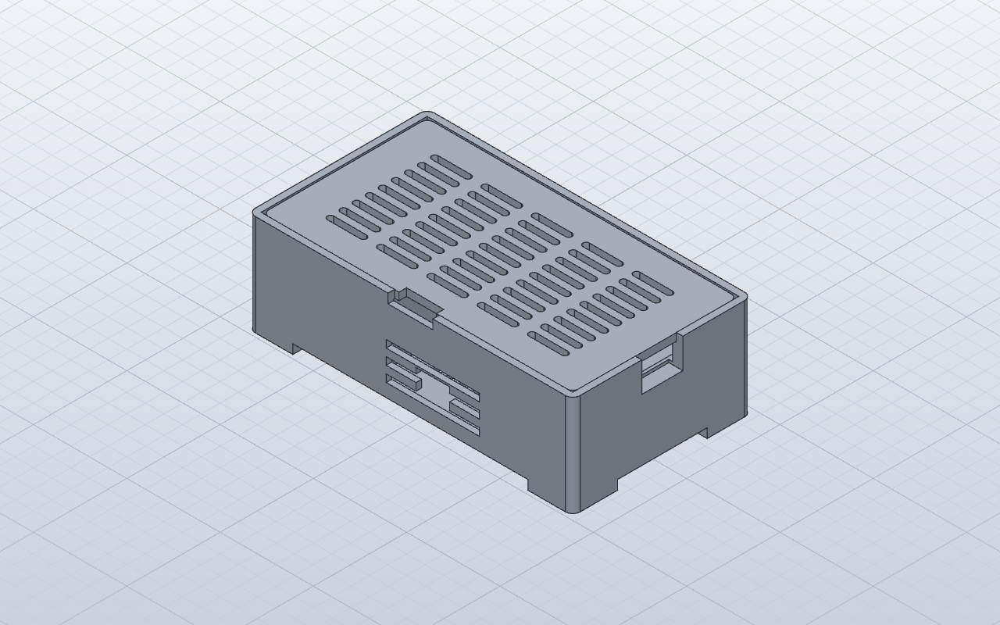
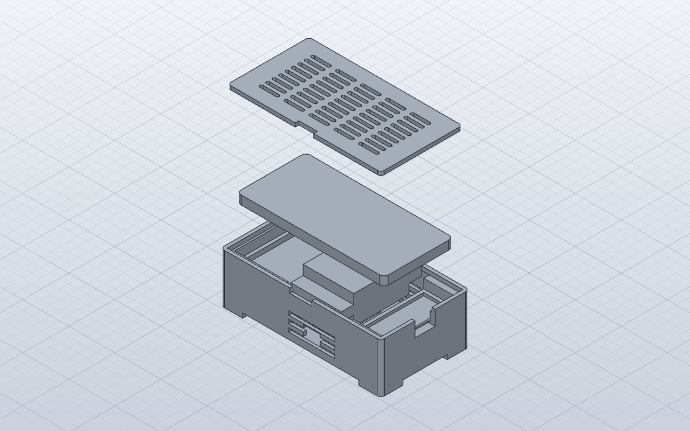

# Gabinete 3D para celular com mini cooler

Caixa ventilada para deixar um celular Android ligado 24/7 como mini servidor de automação, com mini cooler de garra.

- Celular suportado: até **75 × 160 × 9,5 mm**.
- Medidas externas: **174 × 96 × 54 mm**.
- Material: **PETG**. Impressora de referência: **Bambu Lab P2S** (bico 0,4 mm).
- Impressão sem suportes.

## Qual arquivo imprimir

| Arquivo | O que é | Tamanho (X × Y × Z) |
|---|---|---|
| `Gabinete_Redmi_Kit_Completo_P2S.3mf` | Projeto pronto para a P2S, com base e tampa já na mesa e perfil de impressão. **Comece por este.** | – |
| `gabinete_base_v6.stl` | Base (caixa). | 174 × 96 × 54 mm |
| `gabinete_tampa_v6.stl` | Tampa interna lisa. | 166,2 × 88,2 × 6 mm |
| `gabinete_tampa_externa.stl` | Tampa externa com grade de ventilação. | 171 × 97 × 13,6 mm |

Use os STLs só para fatiar em outro slicer ou outra impressora.

## Montagem

Ordem das peças, de baixo para cima: base, tampa interna lisa, tampa externa ventilada. A base tem recortes laterais para cabo e ventilação.

<!-- PREENCHER: passo a passo real da montagem do vídeo (onde o celular e o mini cooler ficam), modelo/link do mini cooler, tensão e origem da energia. -->

## Configuração de impressão (extraída do 3MF)

| Parâmetro | Valor |
|---|---|
| Perfil | `0.20mm Standard @BBL P2S` |
| Filamento | Bambu PETG Basic |
| Altura de camada | 0,2 mm |
| Paredes | 3 |
| Camadas topo / base | 4 / 3 |
| Preenchimento | 15 % gyroid |
| Bico | 250 °C |
| Mesa | PEI texturizada |
| Suportes | não |
| Tempo estimado | ~6 h 50 min (placa completa) |

Meça o seu celular e compare com 75 × 160 × 9,5 mm antes de imprimir.

## Usando com o Android Agent Kit

Com o celular dentro do gabinete, controle-o por ADB Wi-Fi seguindo o [README principal](../README.md).

## Licença
Arquivos de projeto do gabinete sob **CC BY-NC 4.0** (Atribuição–NãoComercial 4.0 Internacional). Atribuição obrigatória e uso comercial não permitido. Texto integral: https://creativecommons.org/licenses/by-nc/4.0/.
